# OfflineMesh

Ứng dụng nhắn tin cho Android **không cần Internet, không cần máy chủ**: các điện thoại ở gần nhau tự truyền tin cho nhau qua **Bluetooth Low Energy**, và chuyển tiếp hộ nhau để tin đi xa hơn tầm sóng của một máy. Thiết kế cho tình huống thiên tai (bão, động đất) khi mạng di động bị mất.

> **Trạng thái:** đang phát triển, bản thử nghiệm, phi thương mại. Có thể có lỗi; tin có thể đến chậm, không đến, hoặc bị mất. **Ứng dụng không thay thế dịch vụ cứu hộ khẩn cấp.** Nếu còn gọi được, hãy gọi số khẩn cấp của địa phương.

- Viết bằng Kotlin, giao diện Jetpack Compose, dùng API Bluetooth gốc của Android (không thư viện truyền tin bên thứ ba). `minSdk 26` (Android 8.0), chỉ chạy dọc.
- Giao diện tiếng Việt, sáng/tối/theo máy.
- Tin riêng được **mã hóa đầu-cuối**; mọi tin đều có **chữ ký**.

---

## 1. Chức năng

| Nhóm | Chức năng |
|---|---|
| Nhắn tin | Tin riêng (văn bản, ảnh) tới người trong danh bạ, mã hóa đầu-cuối. Tin công khai (văn bản, ảnh) gửi cho mọi người ở gần. Nhấn giữ để sao chép chữ; lưu ảnh nhận được về thư viện máy. |
| Trạng thái tin | Tin riêng: *đang chờ máy gần* → *đã chuyển đi* → *đã nhận* (máy người nhận đã nhận, không có nghĩa là đã đọc). Tin công khai/SOS: *đang chờ máy gần* → *đã phát*. |
| Lưu - mang - chuyển tiếp | Người nhận ở ngoài tầm sóng lúc gửi vẫn nhận được sau đó: các máy giữ tạm và chuyển hộ khi gặp nhau. Có giới hạn số hop, thời gian sống, số bản sao để không tràn mạng. |
| SOS | Phát tin cầu cứu tới mọi người ở gần, chọn câu soạn sẵn hoặc tự nhập, có thể kèm ảnh. Phát lại tự động theo lịch giãn dần (1 phút, 2, 4, 8, 16, 32 phút, tối đa 1 giờ một lần) cho tới khi bấm "Tôi an toàn" hoặc hết thời hạn (5 phút đến 12 giờ, mặc định 2 giờ). Người nhận chỉ thấy một mục cho mỗi SOS (bản mới nhất) và chỉ được báo âm ở lần đầu. |
| Chế độ khẩn cấp | Chỉ gửi được SOS khi đã bật (có hộp thoại xác nhận, tránh bấm nhầm). Tiết kiệm pin tối đa, chuyển tiếp hộ người khác chỉ văn bản ngắn và ảnh nhỏ. Có nút tắt ngay đầu mục SOS: tắt sẽ gửi "Tôi an toàn" và dừng phát lại. |
| Vị trí trong SOS | Mặc định **tắt**. Nếu bật, SOS kèm tọa độ. Nếu tắt, người nhận vẫn thấy một **cận trên khoảng cách** ước lượng từ số hop và tuổi tin, không lộ vị trí của ai. |
| Danh bạ ghim khóa | Thêm liên hệ bằng quét mã QR (gặp trực tiếp) hoặc dán thẻ `OM1:…`. Khóa được ghim: tin từ liên hệ hiện ✔ khi đúng khóa đã ghim. |
| Người lạ | Người chưa có trong danh bạ mà nhắn riêng cho bạn hiện thành cuộc trò chuyện **chỉ đọc**, đánh dấu ⚠ (chưa xác minh), có nút *Xóa người này* và *Chặn*. Người đăng công khai không phải "người lạ": tin của họ nằm trong mục *Công khai*. |
| Chỉ nhận tin riêng từ danh bạ | Công tắc trong Cài đặt: bật thì tin riêng của người lạ bị bỏ, không lưu. Tin công khai và SOS luôn nhận. |
| Chặn | Tin riêng và tin công khai của người bị chặn bị bỏ qua. **SOS vẫn được nhận** để không bỏ sót người cần cứu. |
| Tự chạy | Mesh tự bắt đầu mỗi lần mở app và khi Bluetooth vừa bật, không có nút "Bắt đầu". Chạy nền bằng dịch vụ nền (thông báo ở mức im lặng, thu gọn). |
| Pin | 3 mức tự đổi theo pin (Đầy đủ ≥ 50%, Tiết kiệm 20–49%, Cực tiết kiệm < 20%; đang sạc thì lên một mức) cộng chế độ khẩn cấp. Có thống kê pin theo từng mức. |
| Lưu tin | Tin cũ tự xóa sau 1 ngày đến 3 tháng (mặc định 1 tháng). Có thể xóa tay tin cũ hơn 1 ngày, 1 tuần, 2 tuần, 1 tháng trong từng cuộc trò chuyện. Chỉ xóa trên máy này. |
| Sao lưu | Tệp `.omb` do bạn chủ động tạo, mã hóa bằng mật khẩu của bạn, gồm danh tính, danh bạ, tin nhắn, ảnh và cài đặt. Lần mở đầu tiên app hỏi có khôi phục không; không bao giờ tự khôi phục. |
| Chia sẻ ứng dụng | Gửi chính file APK cho máy khác qua Bluetooth khi không có Internet. |
| Thông báo | Tin thường và SOS có công tắc thông báo và âm thanh riêng. |

---

## 2. Cài đặt và dùng nhanh

### Cài đặt
1. Vào mục **Releases** của repo, tải file `.apk` mới nhất về máy Android.
2. Mở file, cho phép **cài từ nguồn không xác định** khi được hỏi, rồi bấm *Cài đặt*.
3. Mở **OfflineMesh**.

Nếu máy khác chưa có app và không có Internet: vào *Cài đặt › Chia sẻ ứng dụng › Chuẩn bị và gửi qua Bluetooth*, chọn máy nhận. Bên nhận cũng cần cho phép cài từ nguồn không xác định.

<table>
<tr>
<td align="center">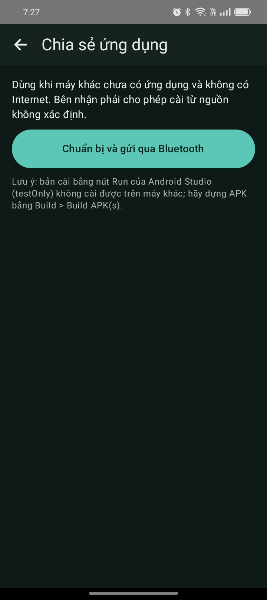<br><sub>Chia sẻ ứng dụng</sub></td>
</tr>
</table>

### Lần đầu mở: 3 bước
1. **Điều khoản sử dụng** (đọc và đồng ý).
2. **Bật Bluetooth** và cấp quyền Bluetooth, thông báo.
3. **Cho phép chạy nền** để nhận tin khi tắt màn hình. Có thể chọn "Để sau", nhưng app sẽ nhắc lại mỗi lần mở cho tới khi được cho phép.

Nếu đã từng sao lưu, bạn sẽ được hỏi có khôi phục từ tệp sao lưu không.

<table>
<tr>
<td align="center">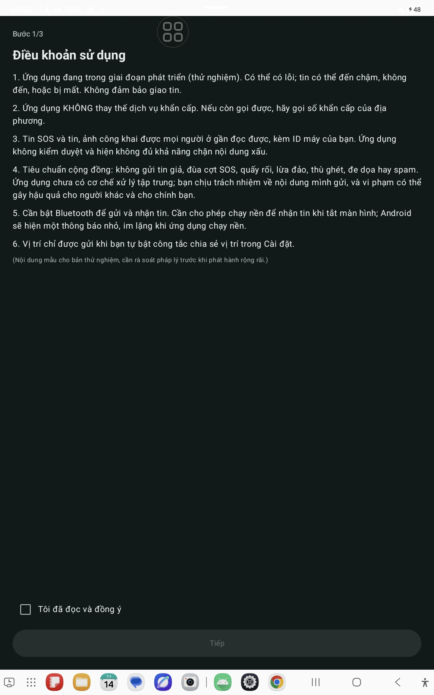<br><sub>Bước 1: điều khoản</sub></td>
<td align="center">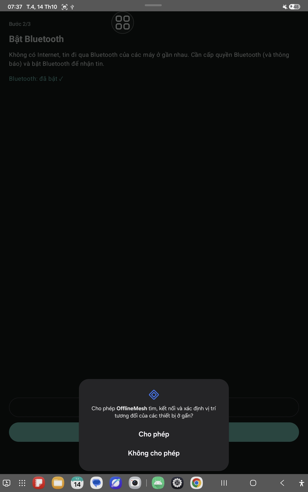<br><sub>Bước 2: Bluetooth và quyền</sub></td>
<td align="center">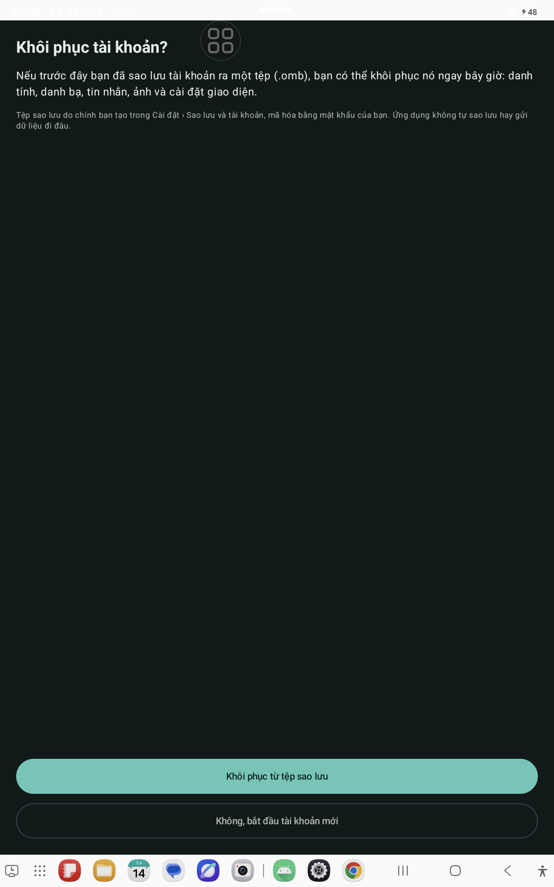<br><sub>Hỏi khôi phục từ tệp sao lưu</sub></td>
</tr>
</table>

### Thêm liên hệ để nhắn riêng
Hai người gặp nhau trực tiếp: vào *Cài đặt › Cá nhân*, một người hiện mã QR, người kia bấm *Quét QR của người kia*. Làm hai chiều. Sau đó đọc to **mã vân tay** cho nhau để chắc chắn đúng người. Không gặp được thì dán thẻ văn bản `OM1:…` vào ô *Hoặc dán thẻ*.

Vì tin riêng được mã hóa đến đúng khóa của người nhận, bạn chỉ nhắn riêng được cho người đã thêm.

### Nhắn tin, công khai và SOS
- **Màn hình chính** là nhắn tin. Mục đầu tiên là **SOS**, rồi **Công khai**, rồi các liên hệ (tên ngắn, không ảnh). Trên điện thoại, bấm nút ba gạch để mở danh sách này; trên máy tính bảng nó hiện bên trái và ẩn được bằng chính nút đó.
- **Công khai**: ai ở gần cũng đọc được, kèm ID máy bạn (lần đầu có cảnh báo). Không dùng để spam hay quấy rối.
- **SOS**: ai cũng đọc được SOS của người khác ở mọi chế độ. Muốn **gửi** thì bấm *Bật chế độ khẩn cấp…*, xác nhận, chọn câu soạn sẵn hoặc nhập, đọc cảnh báo rồi gửi. SOS tự phát lại cho tới khi bạn bấm **Tôi an toàn**. Chỉ gửi khi thật sự cần.

<table>
<tr>
<td align="center">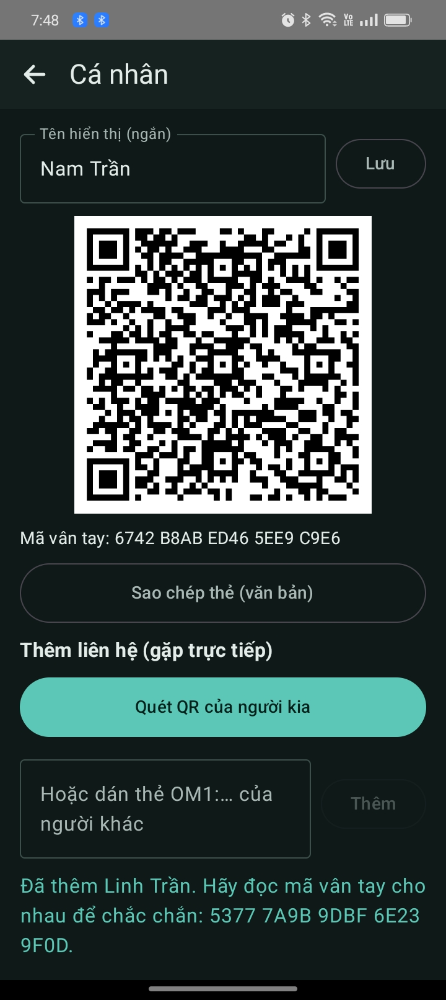<br><sub>Cá nhân: tên, QR, mã vân tay, thêm liên hệ</sub></td>
<td align="center">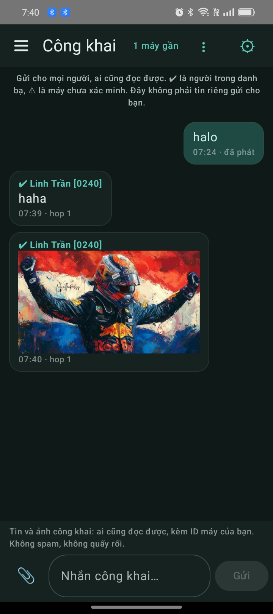<br><sub>Công khai (có ✔ là người trong danh bạ)</sub></td>
<td align="center">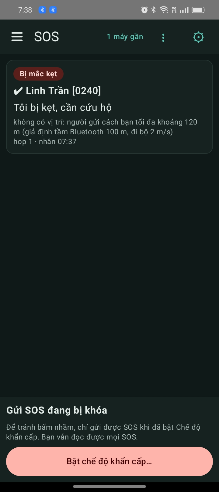<br><sub>SOS: đọc được luôn, gửi bị khóa tới khi bật chế độ khẩn cấp</sub></td>
</tr>
</table>

### Cài đặt
<table>
<tr>
<td align="center">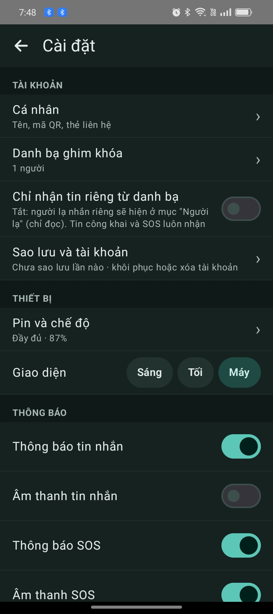<br><sub>Cài đặt: tài khoản, danh bạ, công tắc "chỉ nhận tin riêng từ danh bạ"</sub></td>
<td align="center">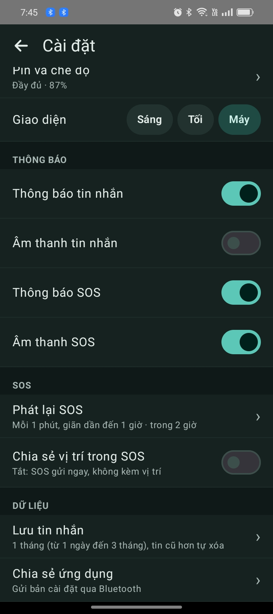<br><sub>Thông báo, SOS, lưu tin, chia sẻ ứng dụng</sub></td>
<td align="center">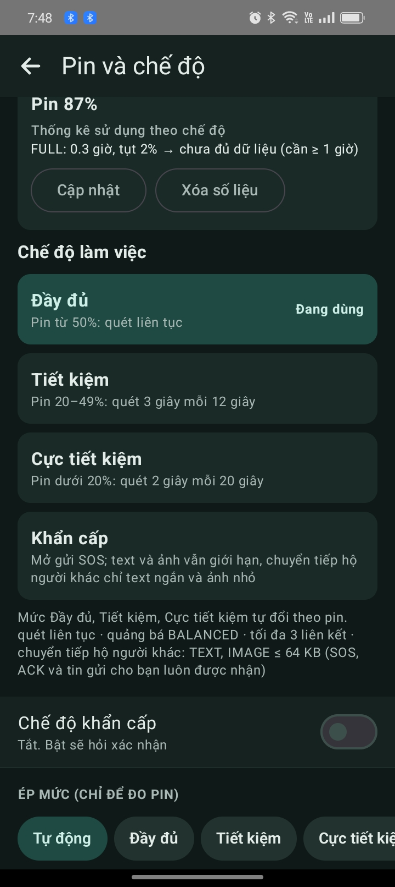<br><sub>Pin và chế độ làm việc, chế độ khẩn cấp</sub></td>
</tr>
<tr>
<td align="center">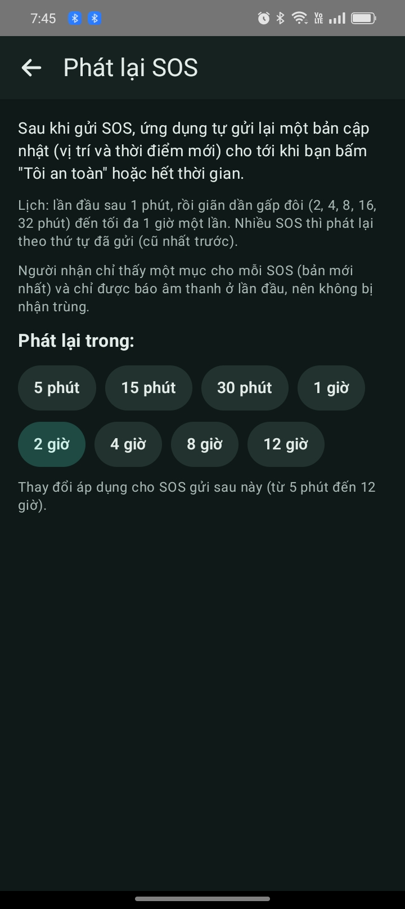<br><sub>Phát lại SOS: thời gian phát lại</sub></td>
<td align="center">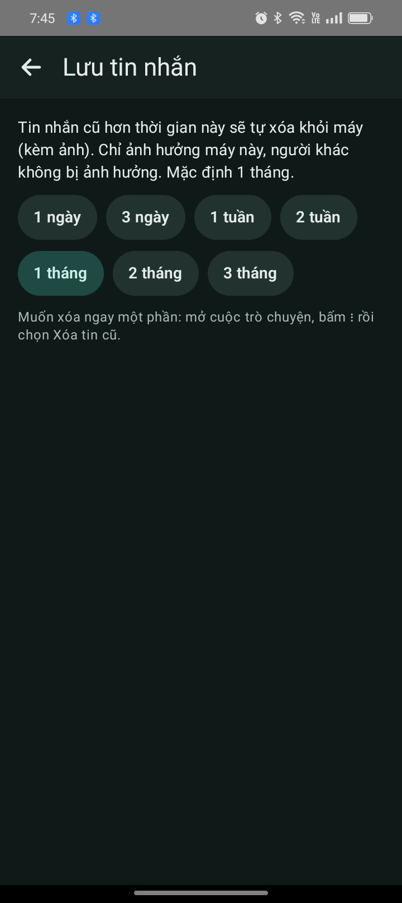<br><sub>Lưu tin nhắn: thời hạn tự xóa</sub></td>
<td align="center">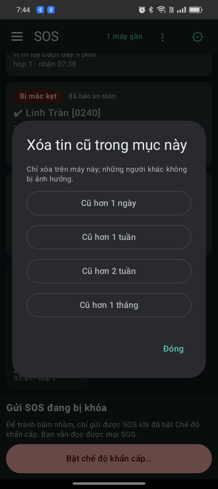<br><sub>Xóa tay tin cũ trong một cuộc trò chuyện (menu ⋮)</sub></td>
</tr>
</table>

### Sao lưu và khôi phục
*Cài đặt › Sao lưu và tài khoản*: **Sao lưu ngay** (đặt mật khẩu từ 8 ký tự, chọn nơi lưu; có tùy chọn kèm ảnh) hoặc **Khôi phục từ tệp sao lưu…**. **Không có cách lấy lại mật khẩu**: quên mật khẩu thì không mở được tệp, và tệp chứa cả khóa riêng của bạn nên hãy giữ kín cả hai. Khôi phục sẽ **thay** toàn bộ dữ liệu hiện có trên máy. Cùng màn hình có nút xóa tài khoản và toàn bộ dữ liệu (không hoàn tác).

<table>
<tr>
<td align="center">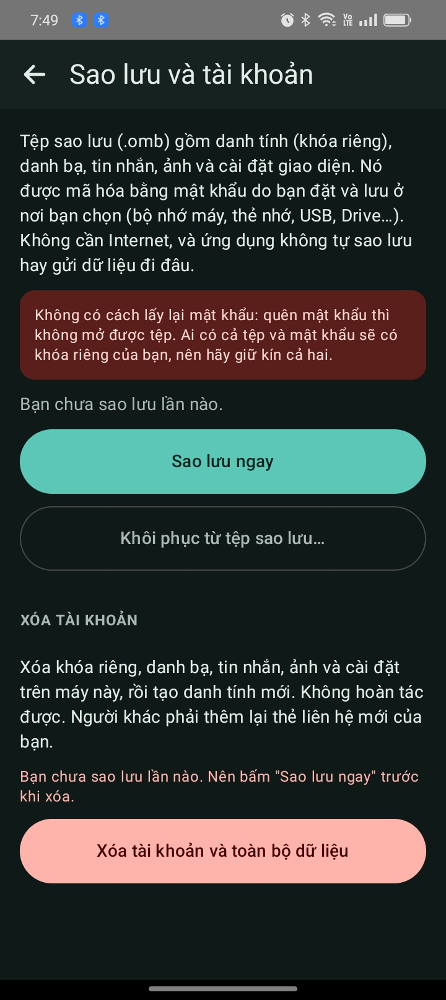<br><sub>Sao lưu và tài khoản</sub></td>
<td align="center">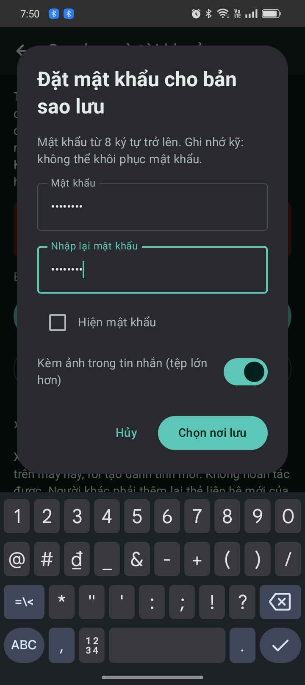<br><sub>Đặt mật khẩu cho bản sao lưu</sub></td>
<td align="center">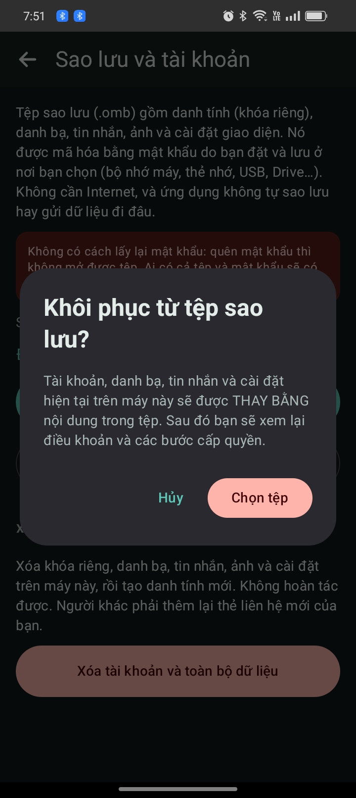<br><sub>Khôi phục: chọn tệp và nhập mật khẩu</sub></td>
</tr>
</table>

---

## 3. Cấu trúc hệ thống

### 3.1. Các lớp

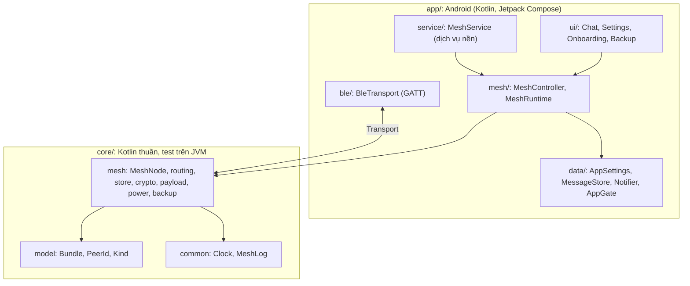

Nguyên tắc: **toàn bộ xử lý nằm trong `core/` (không phụ thuộc Android), giao diện chỉ đọc trạng thái và gọi lệnh qua `MeshController`**, nên đổi giao diện không ảnh hưởng logic, và logic kiểm thử được trên máy tính.

### 3.2. Thư mục

```
core/
  model/    Bundle (tin), PeerId, Kind (ACK, SOS, TEXT, IMAGE, VIDEO), mã lỗi
  common/   Clock, MeshLog (log có mã lỗi cố định)
  mesh/
    node/       MeshNode: bộ máy lưu-mang-chuyển tiếp
    link/       LinkSession: máy trạng thái của một lần gặp
    codec/      BundleCodec, LinkCodec, Framing (đóng gói, chia mảnh)
    routing/    Spray and Wait, giới hạn kích thước, giá trị mặc định
    store/      RelayCache (bộ nhớ chuyển tiếp), BundleStore
    transport/  giao diện Transport, hàng đợi gửi, chính sách kết nối, mạng giả để test
    crypto/     P-256, HKDF, AES-GCM, SealedBox, Identity, ContactBook, ContactCard
    payload/    SOS (SosPayload, SosReplay, SosFeed, SosReach), ảnh (ImagePayload, ImageCompressor)
    power/      PowerPolicy (mức pin), BatteryStats
    history/    StoredMessage, InboundPolicy (quyết định lưu/bỏ tin đến)
    settings/   Retention (thời hạn lưu tin)
    backup/     BackupCodec (.omb), PrefsText, RestorePlan
    sim/        mô phỏng nhiều máy để chỉnh tham số
app/
  ble/      BleTransport, BleConstants: lớp truyền qua GATT
  mesh/     MeshController (ranh giới UI ↔ lõi), MeshRuntime (chạy lõi trên luồng riêng)
  service/  MeshService: dịch vụ nền
  data/     AppSettings, MessageStore, Notifier, AppGate, Emergency, AccountManager
  crypto/   AndroidSecretStore (bọc khóa riêng bằng Android Keystore), ContactsController
  power/    PowerController, BatteryRecorder
  location/ LocationProvider
  media/    UriImageEncoder, ImageSaver
  apk/      ApkShare (chia sẻ chính APK)
  ui/       AppRoot, ChatScreen, SettingsScreens, Onboarding, BackupScreen, RestoreFlow, Theme
```

### 3.3. Tin (bundle) và giới hạn

Mọi thứ truyền đi là một **bundle**: phần bất biến được ký (id, người gửi, người nhận hoặc rỗng nếu phát cho mọi người, loại, thời gian sống, số hop tối đa, nội dung, khóa công khai ký) cộng phần thay đổi dọc đường (số hop, tuổi, số bản sao). `id` là 8 byte đầu của SHA-256 trên phần bất biến. `PeerId` (ID máy) là 6 byte đầu của SHA-256 trên khóa công khai ký.

| Loại | Nội dung tối đa | Sống | Hop tối đa | Bảo vệ |
|---|---|---|---|---|
| Tin riêng (TEXT, có người nhận) | 4 KB | 48 giờ | 12 | ký + mã hóa đầu-cuối |
| Tin công khai (TEXT, không người nhận) | 4 KB | 48 giờ | 12 | ký, không mã hóa |
| Ảnh (riêng hoặc công khai) | 64 KB (ứng dụng nén JPEG xuống vài chục KB) | 48 giờ | 12 | như trên |
| SOS | 512 B | 72 giờ | 12 | ký, không mã hóa |
| ACK | 32 B | theo tin gốc | 12 | ký |

Giá trị là khởi điểm, chỉnh được bằng mô phỏng (`core/.../sim`). Loại VIDEO có trong lõi nhưng ứng dụng chưa gửi video.

### 3.4. Mỗi lần hai máy gặp nhau

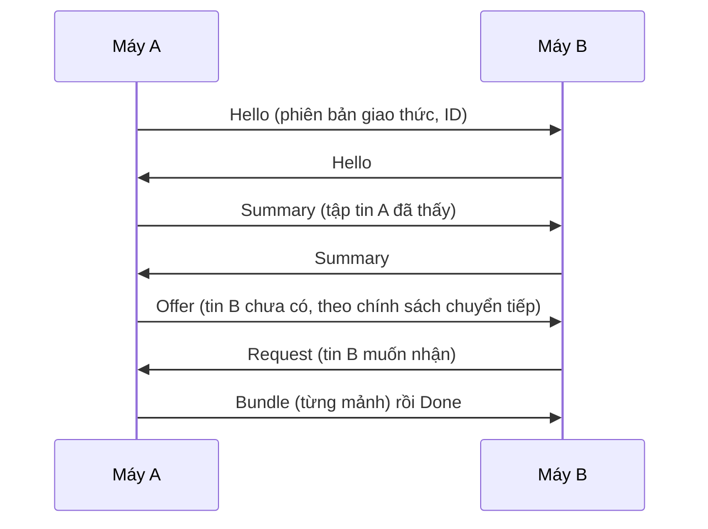

Hai chiều chạy song song và đối xứng. Một phiên đi qua các trạng thái `IDLE → HANDSHAKE → EXCHANGE → TRANSFER → DONE/FAILED`, mỗi lần chuyển trạng thái đều ghi log kèm lý do. Hai máy khác phiên bản giao thức (hiện là **2**) sẽ từ chối nhau.

### 3.5. Định tuyến

- **Tin phát cho mọi người** (SOS, công khai, ACK): lan có kiểm soát, mỗi máy chỉ đưa cho máy chưa có, dừng khi hết hop hoặc hết hạn.
- **Tin riêng**: *Spray and Wait* nhị phân. Máy gốc có `L` bản sao (token); gặp máy khác thì trao một nửa; còn 1 token thì giữ và chờ gặp đúng người nhận. Gặp đúng người nhận thì luôn trao tận tay. Hop cuối chỉ dành cho người nhận.
- **ACK**: khi nhận được tin riêng, máy nhận phát một ACK có chữ ký để các máy giữ bản sao dọn đi và để người gửi hiện "đã nhận".
- **Bộ nhớ chuyển tiếp** (`RelayCache`): có hạn mức riêng cho từng loại tin (một loạt ảnh không đẩy SOS ra khỏi bộ nhớ); khi đầy thì đuổi bản còn ít thời gian sống nhất.

### 3.6. Lớp truyền Bluetooth LE

- Mỗi máy vừa là **peripheral** (quảng bá và mở GATT server) vừa là **central** (quét và kết nối tới máy khác).
- Một dịch vụ GATT với hai đặc tính: máy khác **ghi** vào `RX` (Write Without Response), máy này **notify** qua `TX`. UUID dịch vụ `7b1c0001-4e6d-4a3b-9c2e-5d1f0a9b8c01`.
- Gói quảng bá mang 4 byte ID máy trong dữ liệu hãng (company id `0xFFFF`, dành cho thử nghiệm). Yêu cầu MTU 247.
- Tần suất quét, kiểu quảng bá và số liên kết đồng thời đổi theo mức pin:

| Mức | Quét | Quảng bá | Liên kết tối đa | Chuyển tiếp hộ người khác |
|---|---|---|---|---|
| Đầy đủ | liên tục | ~250 ms | 3 | văn bản và ảnh ≤ 64 KB |
| Tiết kiệm | 3 giây mỗi 12 giây | ~1 giây | 2 | văn bản và ảnh ≤ 32 KB |
| Cực tiết kiệm | 2 giây mỗi 20 giây | ~1 giây | 1 | chỉ văn bản ≤ 1 KB |

Chế độ khẩn cấp không vượt quá mức *Tiết kiệm*. Tin gửi cho chính bạn, SOS và ACK luôn được nhận ở mọi mức. Trạng thái pin chỉ được đọc khi có sự kiện pin/chế độ đổi, không đọc định kỳ; trạng thái Bluetooth được kiểm tra lại mỗi lần khởi động dịch vụ.

### 3.7. Xử lý tin đến

`InboundPolicy` (thuần, có test) quyết định mỗi tin đến sẽ vào đâu:

| Tin đến | Kết quả |
|---|---|
| SOS | Luôn lưu (kể cả từ người bị chặn). |
| Từ người bị chặn | Bỏ. |
| Công khai | Vào mục *Công khai*; công tắc "chỉ nhận từ danh bạ" không áp dụng. |
| Riêng, từ liên hệ có khóa đã ghim | Vào cuộc trò chuyện với liên hệ, hiện ✔. |
| Riêng, từ ID trùng liên hệ nhưng **khác khóa** | Bỏ (chống mạo danh, vì ID chỉ dài 6 byte). |
| Riêng, từ người lạ | Bỏ nếu bật "chỉ nhận từ danh bạ"; không thì lưu thành cuộc trò chuyện chỉ đọc có ⚠. |

### 3.8. Mật mã và quyền riêng tư

Chỉ dùng thuật toán chuẩn của JCA, **không tự chế**:

| Việc | Phương pháp |
|---|---|
| Ký mọi tin, xác minh ở mọi máy kể cả máy trung gian | ECDSA P-256 + SHA-256; khóa công khai đính kèm phải băm ra đúng ID người gửi |
| Mã hóa tin riêng | Kiểu ECIES/HPKE: khóa tạm ECDH P-256 → HKDF-SHA256 → AES-256-GCM (mỗi tin một khóa tạm) |
| Khóa riêng trên máy | Bọc bằng khóa AES-256-GCM nằm trong Android Keystore |
| Tệp sao lưu `.omb` | PBKDF2-HMAC-SHA256 (≥ 600.000 vòng) + AES-256-GCM |

Cần biết:
- **SOS và tin công khai có chữ ký nhưng không mã hóa**, kèm ID máy; ai ở gần cũng đọc được và không thể gửi ẩn danh.
- Tin riêng chỉ người nhận giải mã được; các máy chuyển tiếp thấy ID người gửi/nhận và kích thước.
- Vị trí chỉ được gửi khi bạn tự bật công tắc chia sẻ vị trí trong SOS (mặc định tắt).
- Sao lưu tự động của Android bị tắt (`allowBackup="false"`), tin nhắn không tự lên đám mây.
- Ứng dụng không dùng Internet và không gửi dữ liệu đi đâu ngoài các máy ở gần.

### 3.9. Quyền Android

Bluetooth (`BLUETOOTH_SCAN`, `BLUETOOTH_ADVERTISE`, `BLUETOOTH_CONNECT`; bản cũ `BLUETOOTH`/`BLUETOOTH_ADMIN` giới hạn tới Android 11), thông báo (`POST_NOTIFICATIONS`), dịch vụ nền (`FOREGROUND_SERVICE`, `FOREGROUND_SERVICE_CONNECTED_DEVICE`), bỏ tối ưu pin (`REQUEST_IGNORE_BATTERY_OPTIMIZATIONS`), vị trí (cần để quét BLE trên Android ≤ 11 và cho công tắc chia sẻ vị trí trong SOS).

---

## 4. Xây dựng và kiểm thử

Yêu cầu: Android Studio và Android SDK. Phụ thuộc chính: Jetpack Compose (Material 3), `zxing:core` và `play-services-code-scanner` (mã QR).

```bash
# Kiểm thử lõi trên JVM (hiện 177 test)
./gradlew :core:common:test :core:mesh:test
```

Tạo APK để cài hoặc chia sẻ: **Build › Build APK(s)**. Lưu ý: bản cài từ nút **Run** của Android Studio là bản `testOnly`, **không cài được trên máy khác**. Hai máy có chữ ký khác nhau thì không cài đè lên nhau được.

Phần `app/` (Android) được kiểm tra trên máy thật; phần `core/` có test tự động gồm: mã hóa và chữ ký, mã hóa/giải mã khung tin, chính sách chuyển tiếp, bộ nhớ chuyển tiếp, giao thức gặp nhau, mô phỏng mạng nhiều máy, chính sách pin, SOS (phát lại, gộp theo phiên, ước lượng khoảng cách), sao lưu/khôi phục, quyết định lưu/bỏ tin đến.

---

## 5. Giới hạn đã biết

- Mới thử trên một số ít máy thật; Bluetooth LE nền và tiết kiệm pin khác nhau tùy hãng máy. Các con số năng lượng, thời gian sống, số bản sao là giá trị khởi điểm.
- Nếu Bluetooth bị tắt rồi bật lại khi app đang ở nền, mesh chỉ chạy lại khi bạn mở app.
- Người dùng có thể tự tắt kênh thông báo "Chạy nền" trong cài đặt hệ thống; app không tự ẩn hoàn toàn được thông báo này vì Android bắt buộc có.
- Chưa có cơ chế xử lý vi phạm cộng đồng tập trung (không có máy chủ); chỉ có chặn ở từng máy. Điều khoản trong app là bản mẫu.
- Chưa gửi video, chưa có bản đồ. Ước lượng vị trí SOS hiện chỉ là cận trên khoảng cách.
- Cần Android 8.0 trở lên; chưa tối ưu giao diện cho mọi cỡ màn hình.
